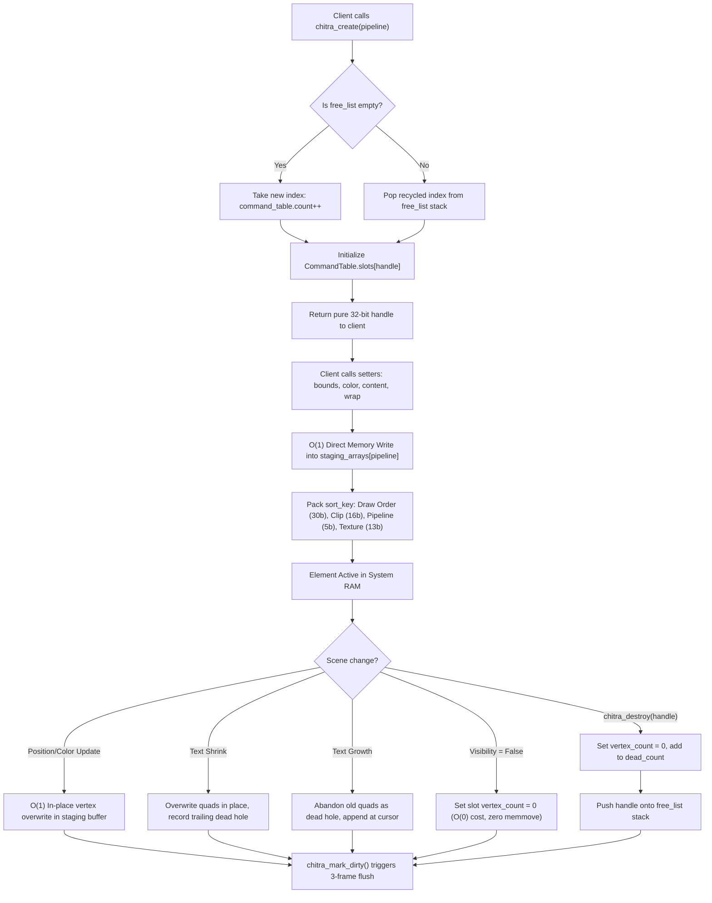
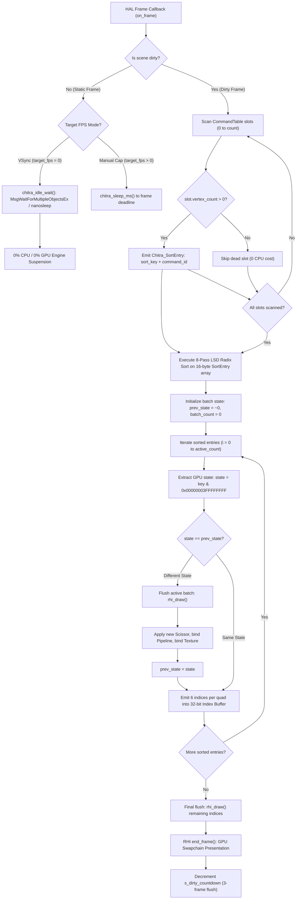
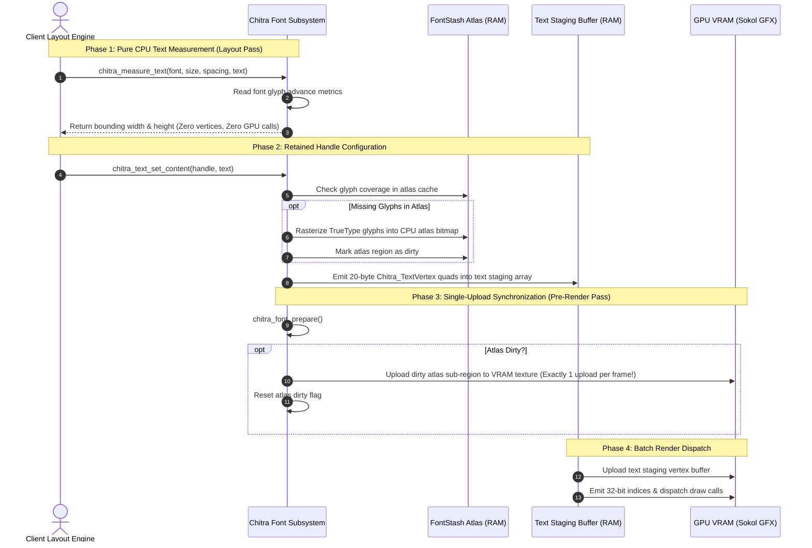
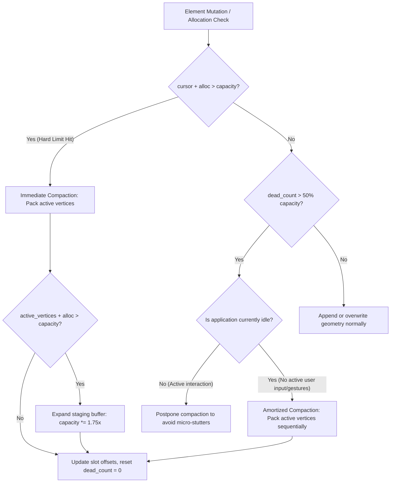

# Chapter 08: Visual Lifecycles and Flowcharts

## 1. Overview of the Engine Data Flow

This chapter illustrates the runtime mechanics of the Chitra 2D engine through visual flowcharts and sequence diagrams. It models the exact lifecycle of element handles, frame pacing, microsecond Radix Sorting, hole-skipping index generation, and state-aware batch coalescing.

```
+------------------------------------------------------------------------+
|                          HIGH-LEVEL DATA FLOW                          |
+------------------------------------------------------------------------+
  Client Application
         │
         │  1. chitra_create() / Property Setters
         ▼
  RAM: CommandTable (16B slots) + Staging Arrays (40B/20B vertices)
         │
         │  2. Collect active slots into 16B Chitra_SortEntry array
         ▼
  RAM: 8-Pass LSD Radix Sort (Key: [DrawOrder:30 | Clip:16 | Pipe:5 | Tex:13])
         │
         │  3. Stream 32-bit Index Buffer (Skip dead holes in O(0))
         ▼
  RAM: State-Aware Batch Coalescing (Bitmask: 0x00000003FFFFFFFF)
         │
         │  4. Minimal GPU Draw Dispatch
         ▼
  VRAM: Sokol GFX Render Pass (Draw Calls, Scissors, Frame Presentation)
+------------------------------------------------------------------------+
```

---

## 2. Element Lifecycle: Reservation to Destruction

The diagram below traces the complete lifecycle of an element handle from initial slot reservation through dynamic property mutation to zero-cost destruction.



### Lifecycle Highlights
1. **$O(1)$ Slot Allocation:** `chitra_create()` acquires an ID in $O(1)$ time without requiring upfront parameters.
2. **Dense LIFO Packing:** Reusing recently destroyed IDs via the `free_list` stack keeps active handles clustered near index `0`, minimizing memory cache footprint.
3. **Zero Memory Moves:** Dynamic text resizes and deletions leave dead holes in staging buffers; vertices are never shifted via `memmove()`.

---

## 3. Frame Execution and GPU Dispatch Pipeline

The diagram below details the per-frame execution pipeline executed when the client presents a frame.



### Pipeline Highlights
1. **Microsecond Sorting:** The 8-pass LSD Radix Sort streams flat 16-byte `Chitra_SortEntry` structs through L1 data cache without conditional branch instructions.
2. **Hole-Skipping Index Stream:** Indices are emitted only for active geometry (`vertex_count > 0`). Dead memory holes in RAM and VRAM are naturally bypassed by the index buffer at zero GPU cost.
3. **State Coalescing:** The 34-bit mask (`0x00000003FFFFFFFF`) strips the top 30-bit Draw Order. Adjacent elements on differing visual layers coalesce into the same draw call if their Scissor Clip, Pipeline, and Texture match.

---

## 4. Typography and Single-Upload Atlas Synchronization

The diagram below illustrates the decoupling between font layout metrics, dynamic glyph rasterization, and GPU texture atlas updates.



### Typography Highlights
1. **Zero-Allocation Layout:** `chitra_measure_text()` evaluates font tables in CPU RAM without generating geometry, allowing Flexbox solvers to calculate layout bounds freely.
2. **Single-Upload Atlas Rule:** New glyphs accumulate in CPU memory during text generation and are uploaded to the GPU texture atlas **exactly once per frame** prior to the render pass.

---

## 5. Memory Compaction and Garbage Collection

The diagram below illustrates the two-tier memory threshold evaluation that compacts staging buffers and recovers memory holes left by text edits or element deletions.



### Compaction Highlights
1. **Hard Limit Protection:** Guarantees OOM prevention by compacting immediately if an allocation would exceed physical buffer capacity.
2. **Amortized Soft Limit:** Compaction triggered by dead hole accumulation (exceeding 50% capacity) executes **only during idle frames**, preventing frame-time spikes during animated dragging or typing gestures.
3. **1.75x Growth Rate:** Provides generous headroom for text appending operations, preventing repeated reallocations.

---

## 6. Architectural Synthesis and Conclusion

The 8 chapters of this manual document a coherent, high-performance 2D engine architecture built upon five non-negotiable principles:

1. **Pure Data-Oriented Design (DOD):** Memory is organized in flat, contiguous arrays matched to 64-byte CPU cache lines, completely eliminating pointer chasing.
2. **Decoupled 30-Bit Draw Order Key:** Separating the 32-bit handle from the 64-bit sort key eliminates artificial Z-Index ceilings, unlocking 1.07 billion layers matching the capacity of the 32-bit index buffer.
3. **Zero-Cost Hole-Skipping:** Dynamic text resizes and element deletions abandon vertices in place; the 32-bit index buffer naturally skips dead holes without expensive `memmove()` CPU stalls.
4. **State-Aware Draw Batch Coalescing:** Evaluating GPU state via the 34-bit bitmask (`0x00000003FFFFFFFF`) merges quads across different layers into the minimum theoretical number of GPU draw calls.
5. **True 0% Idle Frame Pacing:** Platform waitable objects suspend CPU and GPU execution completely when the scene is static, paired with a 3-frame flush for multi-buffered display compositors.

### Manual Navigation
* **[01. Architecture Overview](01_architecture_overview.md)**: System layers, modular pillars, and client contracts.
* **[02. Memory Model and Data Structures](02_memory_model_and_structures.md)**: Dynamic 2-table model and per-pipeline staging arrays.
* **[03. Sorting and Draw Batching Pipeline](03_sorting_and_batch_pipeline.md)**: 64-bit Radix Sort keys and 34-bit state coalescing.
* **[04. Asset Subsystems (Fonts and Vectors)](04_asset_subsystems.md)**: Typography, atlas synchronization, and SVG triangulation.
* **[05. Source Tree and File Responsibilities](05_file_responsibilities.md)**: Physical directory layout and header boundaries.
* **[06. API Reference and Client Integration](06_api_reference_and_integration.md)**: C99 API signatures, reservation handles, and event systems.
* **[07. Architectural Decision Records (ADRs)](07_architectural_decisions.md)**: Formal rationale and engineering trade-offs.
* **[08. Visual Lifecycles and Flowcharts](08_visual_flowcharts.md)**: Visual sequence diagrams and data flow maps.
